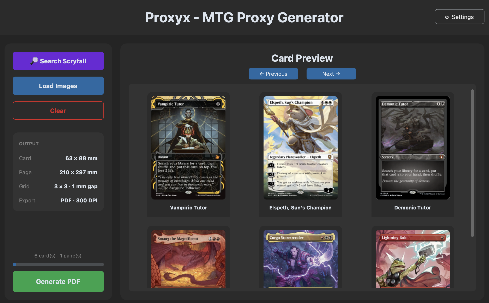
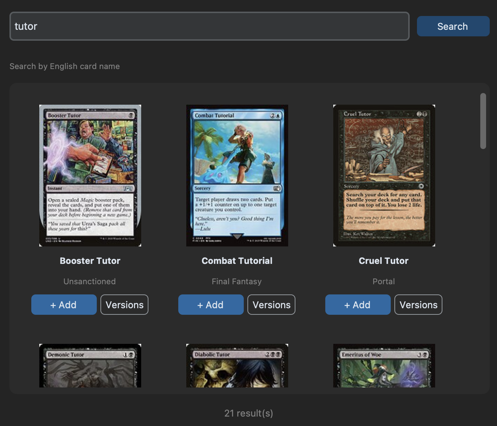
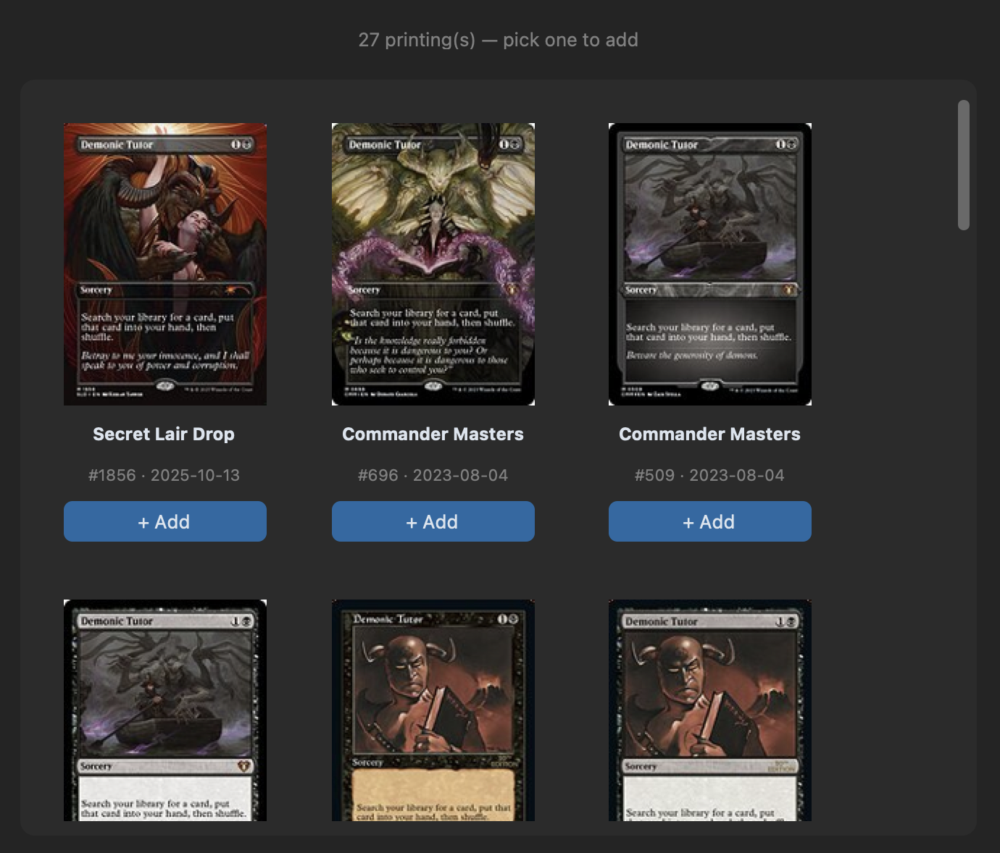
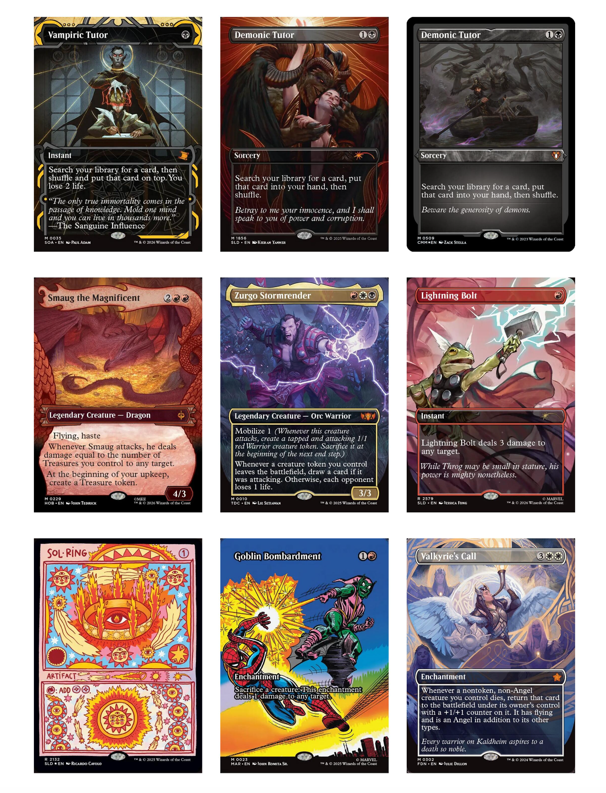

<div align="center">

# ⚡ Proxyx - MTG Proxy Generator

Turn Magic: The Gathering card images into print-ready proxy sheets in seconds.

<p align="center">
  <a href="#"></a>
  <a href="#"></a>
  <a href="#"></a>
  <a href="#"></a>
  <a href="#"></a>
</p>

</div>

> **Unofficial fan project.** Proxyx is not affiliated with, endorsed by, or sponsored by Wizards of the Coast or Scryfall. Proxies are for personal playtesting only and must never be sold or passed off as genuine cards. See the [Disclaimer](#disclaimer).


## ✨ Overview

Proxyx is a desktop application that lays out Magic: The Gathering card images on A4 sheets and exports them to a print-ready PDF, at the exact size of a real card (63 × 88 mm).

It was built to solve a simple problem: playtesting a deck idea before buying the cards, without spending hours resizing images in an editor.


## 🚀 Features

✅ Search cards by name through the [Scryfall](https://scryfall.com) API
<br>
✅ Pick a specific printing among all the versions of a card
<br>
✅ Load your own images from disk
<br>
✅ Multi-page preview with pagination
<br>
✅ Automatic 3 × 3 grid layout at real card size
<br>
✅ PDF export at 300 DPI
<br>
✅ Page size, grid, card size and DPI configurable in `settings.json`


## 📸 Screenshots

### Main window

<p align="center">
  
</p>

### Scryfall search

<p align="center">
  
</p>

### Choosing a printing

<p align="center">
  
</p>

### Generated printable layout

<p align="center">
  
</p>


## ⬇ Installation

There are no prebuilt executables: Proxyx runs from source. You need [Python 3.10+](https://www.python.org/downloads/) and [Git](https://git-scm.com/downloads).

**1. Get the code**

```bash
git clone https://github.com/elianAlde/proxyx.git
cd proxyx
```

**2. Create a virtual environment and install Proxyx**

macOS / Linux:

```bash
python3 -m venv venv
source venv/bin/activate
pip install -e .
```

Windows (PowerShell):

```powershell
python -m venv venv
venv\Scripts\activate
pip install -e .
```

**3. Launch the app**

```bash
proxyx
```

Next time, just open the folder, activate the environment again (`source venv/bin/activate`, or `venv\Scripts\activate` on Windows) and run `proxyx`.


## 🃏 Usage

1. Add cards with **🔎 Search Scryfall** (use **Versions** to pick a specific printing) or with **Load Images**
2. Browse the pages with **← Previous** / **Next →**
3. Click **Generate PDF** and print the file


## 🔧 Configuration (`settings.json`)

| Field | Default | Meaning |
|---|---|---|
| `dpi` | `300` | Resolution of the generated PDF |
| `page_width_mm` | `210` | Sheet width (A4) |
| `page_height_mm` | `297` | Sheet height (A4) |
| `cols` | `3` | Cards per row |
| `rows` | `3` | Rows per page |
| `card_width_mm` | `63` | Card width |
| `card_height_mm` | `88` | Card height |

Missing fields fall back to their default value. Images downloaded from Scryfall are cached in `~/.proxyx/scryfall_cache`.


## 🖨 Printing Tips

- Print at 100% scale, with "fit to page" disabled
- Use high quality settings on thick or matte photo paper
- Sleeve the proxy in front of a basic land for a sturdier feel


## 🩺 Troubleshooting

| Problem | Fix |
|---|---|
| `command not found: proxyx` | The virtual environment is not active: run `source venv/bin/activate` (Windows: `venv\Scripts\activate`) from the `proxyx` folder |
| `No module named '_tkinter'` | Your Python build ships without Tk. On macOS with Homebrew: `brew install python-tk` |
| Printed cards have the wrong size | Set the print scale to 100% and disable "fit to page" in the print dialog |


## 🧑‍💻 Development

```bash
pip install -e ".[dev]"
pytest
```

The tests cover the pure logic: mm → pixel conversion, page layout, Scryfall response parsing and configuration loading.

| Module | Responsibility |
|---|---|
| `config.py` | Loads `settings.json` into a dataclass |
| `generator.py` | Layout math and PDF rendering |
| `scryfall.py` | Scryfall API client and image cache |
| `gui.py` | CustomTkinter interface |
| `main.py` | Command line entry point |


## 🛠 Tech Stack

| Technology | Purpose |
|---|---|
| Python | Application logic |
| CustomTkinter | Desktop interface |
| Pillow | Image processing and PDF export |
| Requests | Scryfall API |
| pytest | Tests |


## 🛣 Roadmap

- [x] 🔎 **Scryfall integration**
  - Search and import cards directly from the app
- [ ] 📋 **Decklist import**
  - Paste a decklist and fetch every card at once
- [ ] 🖨 **Advanced print controls**
  - Bleed margins
  - Crop marks
  - Printer calibration


<a id="disclaimer"></a>

## ⚖️ Disclaimer

**Unofficial Fan Content.** Proxyx is unofficial Fan Content permitted under the [Fan Content Policy](https://company.wizards.com/en/legal/fancontentpolicy). Not approved/endorsed by Wizards. Portions of the materials used are property of Wizards of the Coast. ©Wizards of the Coast LLC.

**No affiliation.** Proxyx is not produced by, endorsed by, supported by, or affiliated with Wizards of the Coast or Scryfall. Magic: The Gathering and all related names, card images, symbols and artwork are trademarks and copyrights of Wizards of the Coast LLC and of the respective artists.

**Personal use only.** Proxyx is meant for personal playtesting and casual play. Proxies made with it must not be sold, traded, or presented as genuine Magic cards, and they are not legal in sanctioned tournaments. Producing counterfeit cards is illegal.

**Free and non-commercial.** Proxyx is free, contains no ads, and does not charge for any feature.

**Card data and images.** Card data and images are provided by the [Scryfall API](https://scryfall.com/docs/api) and remain the property of their respective owners. The app does not bundle any card image: images are downloaded on demand and cached only on the user's computer. Cards shown in the screenshots above are used for illustration only.

**User responsibility.** Users are responsible for the images they load and for how they use the generated files.

**License scope.** The MIT License applies to the source code of this repository only. It grants no rights over Magic: The Gathering content, card images, or artwork.


## 🤝 Contributing

Suggestions and feature requests are welcome: open an issue or a pull request.


## 📜 License

The source code is distributed under the [MIT License](LICENSE).


---
<div align="center">

Built with ❤️ for the Magic community

</div>
